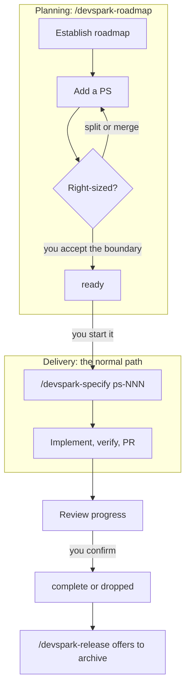

# Roadmap Guide

`/devspark-roadmap` keeps an optional roadmap for your application: where it is going, and the right-sized increments that get it there. Each increment is a **Prospective Spec** (PS), a short planning document that describes one outcome you could ship on its own.

> Roadmap the direction. Deliver through one flow. Measure outcomes. Adapt deliberately.

The roadmap is not a project-management system, a second delivery lifecycle, or a gate. DevSpark works exactly the same without one: no change, fix, experiment, or release needs a roadmap. Use it when you want to think ahead before you start building, then deliver each piece through the normal `/devspark-specify` path.

## When to use it

Use a roadmap when:

- you are planning more than one change toward a larger goal, and want to agree the order and boundaries first;
- several people need a shared picture of what comes next and why;
- you want to check, later, whether what you shipped still matches what you meant to ship.

Skip it when you already know the one change you want. Run `/devspark-specify` directly.

## The lifecycle at a glance



The roadmap command only writes roadmap files. Delivery starts only when you run `/devspark-specify`; the roadmap never starts it for you.

## Quick start

Ask in plain language. Each step below is one prompt; the agent proposes, and writes only after you agree.

1. **Create the roadmap.** The agent looks at the application first, so the baseline is factual, then proposes a direction and a few themes.

   ```text
   /devspark-roadmap establish a roadmap for this application
   ```

2. **Add a Prospective Spec** for each outcome you have in mind. It is created as `proposed` with the next free id.

   ```text
   /devspark-roadmap add a Prospective Spec for exporting tasks as CSV
   ```

3. **Right-size it.** The agent applies the right-sizing test (below) and suggests a merge or split if needed. When you accept the boundary, it is marked `ready`.

   ```text
   /devspark-roadmap is ps-001 right-sized?
   ```

4. **Pick what to start.** The agent lists items whose dependencies are delivered and recommends one, with reasons. You choose.

   ```text
   /devspark-roadmap what is ready to start?
   ```

5. **Start delivery** through the normal path. Specify reads the PS as context and creates the work branch.

   ```text
   /devspark-specify ps-001
   ```

6. **Review progress** once work is underway or merged. The agent compares the roadmap with branches, commits, code, tests, and Knowledge.

   ```text
   /devspark-roadmap review progress against what we delivered
   ```

7. **Resolve the item** when the evidence shows it shipped (or you decide not to pursue it).

   ```text
   /devspark-roadmap mark ps-001 complete
   ```

8. **Release.** `/devspark-release` offers to archive resolved items with the release. Saying no changes nothing else.

## Where the roadmap lives

By default the roadmap lives in your repository, under `.devspark.work/roadmap/`:

```text
.devspark.work/roadmap/
  roadmap.md                      direction, baseline, themes, decisions, delivered records
  specs/
    ps-002-share-a-list.md        live items: proposed, ready, active
    ps-003-export-pdf.md
    complete/
      ps-001-export-tasks.md      resolved items (complete or dropped), staged until release
```

The command finds the roadmap in this order:

1. `--root <path>` in your request, for example `/devspark-roadmap --root ../planning/roadmap review progress`;
2. `roadmap.root` in `.devspark.work/devspark.json` (repository-relative or absolute);
3. the default `.devspark.work/roadmap/`.

```json
{
  "roadmap": {
    "root": "../planning/roadmap"
  }
}
```

A location outside the repository (a separate planning repository or folder) is used only when you name it with `--root` or configure it. That explicit choice is what allows the command to write there; it never searches for a nearby planning folder. If you mention a location without `--root`, the agent re-runs the check with `--root` rather than guessing.

If there is no roadmap at the resolved location, the command says so, notes that a roadmap is optional, and stops, unless you asked it to establish one.

## What you can ask

One request can combine several of these.

| Request | Example | What happens |
|---|---|---|
| Establish or revise | `establish a roadmap for this application` | Assesses the application, proposes direction and themes, writes `roadmap.md` after you agree |
| Add a PS | `add a Prospective Spec for exporting reports` | Creates `specs/<id>-<slug>.md` as `proposed` and links it from its theme |
| Right-size a PS | `is ps-004 right-sized?` | Applies the right-sizing test; proposes a merge or split; marks `ready` only when you accept |
| Dependencies and future health | `what does ps-004 depend on?` | Explains delivered prerequisites, debt it should leave cleaner, and options it must not close off |
| What is ready | `what is ready to start?` | Lists unblocked items and recommends one; you choose |
| Review progress and drift | `review progress against what we delivered` | Compares items with delivery evidence and proposes corrections |
| Record a decision | `record that we will support CSV before PDF` | Adds an approved decision, with its basis, to Decisions or to the PS it shapes |
| Resolve an item | `mark ps-002 complete` or `drop ps-003` | Sets the status after you confirm, then stages the file under `specs/complete/` |
| Check structure | `check` | Runs the structural check and reports findings |

## Writing a Prospective Spec

A PS is the smallest cohesive, independently verifiable and shippable increment that advances the roadmap.

> **Tasks divide implementation work. Prospective Specs divide deliverable outcomes.**

Each PS is a Markdown file with YAML metadata and six short sections:

```markdown
---
id: ps-001
title: Export tasks as CSV
status: proposed        # proposed | ready | active | complete | dropped
order: 10               # optional; lower comes first
depends_on: []          # ids of delivered prerequisites, e.g. [ps-001]
delivery: []            # branch, commit, or pull request references once delivery starts
---

# ps-001: Export tasks as CSV

## Outcome
A user can download their task list as a CSV file they can open in a spreadsheet.

## Current Reality
Tasks are visible only in the app; there is no export (see the task list page and its tests).

## Scope and Independence
In scope: one CSV export of the current user's tasks. Out of scope: scheduled exports, other formats.
If this shipped and nothing else on the roadmap did, the app would still be complete and releasable.

## Future Health
Keep the export behind the existing task query so a later PDF export can reuse it.

## Dependencies and Decisions
None. CSV first was agreed before PDF (see Decisions in roadmap.md).

## Completion Expectations
A user can export, the file opens cleanly, and existing task views are unchanged.
```

Keep it short. A PS never contains task lists, file-by-file plans, test inventories, line-level instructions, or status audits. Once delivery starts, the branch and its code, tests, and Knowledge own the detail. Keep only the current assessment in the PS; Git keeps its history.

Ids are permanent and never reused. The agent takes the next free id from the structural check, so do not pick one by hand.

## Right-sizing

The test is one question:

> *If this PS were completed and every later roadmap item were canceled, would the application remain healthy, complete, and releasable?*

A right-sized PS is:

- **Complete and verifiable.** It delivers a whole capability or technical outcome, with an observable completion boundary.
- **Autonomous and shippable.** No unfinished future PS is needed to complete, repair, or activate it. A complete capability may ship intentionally inactive.
- **Right-sized.** Neither a fragment nor a bundle of separately shippable outcomes.
- **Future-preserving and technically responsible.** It keeps credible future options open, avoids unnecessary coupling, adds no unjustified debt, and leaves what it touches at least as healthy as it found it.

An **undersized** PS usually depends on unfinished work; the agent proposes merging it into the outcome it serves. An **oversized** PS combines outcomes that could ship separately; the agent proposes a split, with ids, before delivery starts. Items are never split to hit a size, duration, or repository-count target.

## Status

| Status | Meaning | Location |
|---|---|---|
| `proposed` | Captured; not yet right-sized | `specs/` |
| `ready` | Right-sized; dependencies delivered or explicitly accepted | `specs/` |
| `active` | Explicitly handed to `/devspark-specify` | `specs/` |
| `complete` | Delivery evidence shows the outcome shipped (merged, at minimum) | `specs/complete/` |
| `dropped` | Intentionally not pursued; the reason stays in the PS | `specs/complete/` |

Planning status is not delivery evidence. Merged is not necessarily deployed, deployed is not necessarily activated, and a complete capability may legitimately ship inactive. When code and Git disagree with the roadmap, code and Git win.

**What counts as ready to start.** The check lists `proposed` and `ready` items whose dependencies are complete, either live in `specs/complete/` or recorded as complete in the roadmap's Delivered section. A dropped or unknown dependency does not count.

## From roadmap to delivery

When you want to build a PS, start it yourself:

```text
/devspark-specify ps-001
```

You can also name the PS file, and add the same `--root` you used for the roadmap. Specify then:

- reads the PS as intake context and checks its "current reality" against the code;
- tells you, in one line, if the PS is missing, ambiguous, or depends on something not yet complete, and lets you decide; this is context, not a gate;
- suggests `/devspark-roadmap` to right-size it if the outcome looks bigger than one shippable increment;
- carries on with the normal workflow and creates the work branch, using the PS id and title (for example `ps-001 export tasks as CSV`) as the branch description.

Specify never edits the roadmap. Recording progress is the roadmap's job: a later progress review can add the branch or pull request to `delivery` and set `status: active` once you confirm.

Specify only reads a roadmap when you name a PS. Otherwise it never looks for one and never mentions roadmaps.

**Where the PS id may appear.** The id is a planning reference. It can appear in a commit message, a pull request description, the branch description, or `work.md`, but never in shipped code, tests, or `.knowledge/`.

## Reviewing progress and drift

A progress review compares each affected PS with local delivery evidence: branches, commits, merged history, code, tests, and current Knowledge. It separates two kinds of drift:

- **Tracking drift.** The recorded status or `delivery` references disagree with the evidence, for example a `ready` item that already has a merged pull request.
- **Product drift.** What was delivered, or what is being prioritized, has moved away from the intended outcomes and direction.

For each, the agent shows the evidence and recommends a correction. It records only what the evidence shows, never inventing deployment or activation. It updates only the affected items, replacing their current assessment rather than appending a review log, and never rewrites direction, decisions, or priorities on its own.

## Resolving and archiving

1. **Resolve.** With your confirmation, the agent sets `status: complete` (citing at least one `delivery` reference) or `status: dropped` (keeping the reason in the PS).
2. **Stage.** A structural repair moves the file to `specs/complete/` and fixes links to it. Staged items stay there until a release.
3. **Archive with a release.** When resolved items are staged, `/devspark-release` offers to archive them. Only if you agree does it move them to `.archive/{YYYY-MM-DD}/roadmap/specs/complete/` with the rest of the release, repoint roadmap links at the archived copies, and add one permanent line per item to the `## Delivered` section of `roadmap.md`:

   ```markdown
   - [ps-001-export-tasks](<path to archived copy>) — complete; archived with release 1.4.0
   ```

Do not edit these links by hand. The Delivered line is what keeps a dependency on an archived item satisfied: `complete` still counts, `dropped` does not. A bare archive link with no status is `unknown`; confirm its status from current code and Git history, then record it in Delivered. Nothing ever reads the archived copy.

A staged item that is malformed, not resolved, a symbolic link, or would relink a roadmap file with uncommitted changes is left in place and listed for your decision. A roadmap outside the repository is never archived from a consumer repository; archive it from its own planning repository. The roadmap never blocks a release.

## The structural check

Every `/devspark-roadmap` request starts with a deterministic check, and runs it again after any edit. You can also run it yourself:

```bash
.devspark/scripts/bash/roadmap-check.sh check
.devspark/scripts/bash/roadmap-check.sh locate ps-001
.devspark/scripts/bash/roadmap-check.sh repair            # plan only; writes nothing
.devspark/scripts/bash/roadmap-check.sh repair --apply    # perform the planned repairs
```

```powershell
.devspark/scripts/powershell/roadmap-check.ps1 check
.devspark/scripts/powershell/roadmap-check.ps1 repair -Apply
```

Add `--root <path>` (`-Root <path>`) for a roadmap elsewhere, and `--json` (`-Json`) for machine-readable output. The exit code is `0` when there are no errors, `1` when there is at least one error, and `2` for a usage error. Warnings never fail the check.

Sample output for a completed item that has not yet been staged:

```text
roadmap check: /src/todo-app/.devspark.work/roadmap (default)
  ps-001 [complete] Export tasks as CSV
  ps-002 [proposed] Share a list
  ERROR misplaced-item: specs/ps-001-export-tasks.md - a complete item belongs in specs/complete/
  unblocked: ps-002; next id: ps-003
  result: NOT OK
```

And the repair plan for it:

```text
  would repair (move): specs/ps-001-export-tasks.md -> specs/complete/ps-001-export-tasks.md
  would repair (relink): roadmap.md
```

### Findings

| Finding | Severity | What to do |
|---|---|---|
| `misplaced-item` | error | A status and folder disagree. Repairable: run `repair`. |
| `broken-link` | error | A local link points nowhere. Repairable when a move caused it; otherwise fix the link. |
| `duplicate-id`, `invalid-id`, `id-filename-mismatch` | error | Each file needs a unique `ps-NNN` id that matches the start of its file name. |
| `missing-field`, `malformed-metadata`, `invalid-status` | error | Fix the YAML metadata. `id`, `title`, and `status` are required. |
| `missing-dependency`, `dependency-cycle` | error | A `depends_on` id does not exist, or items depend on each other in a loop. |
| `conflicting-archived-status` | error | Delivered records the same id as both complete and dropped. Keep the correct one. |
| `unsafe-path` | error | A symbolic link, or a path outside the roadmap root. It is never read or written. |
| `complete-without-delivery` | warning | Add the branch, commit, or pull request that delivered it. |
| `status-behind-delivery` | warning | A `proposed` or `ready` item already has delivery references; confirm its status. |
| `unresolved-delivery-ref` | warning | A recorded commit hash is not in this repository. |
| `depends-on-dropped` | warning | A prerequisite was dropped; rethink the dependency. |
| `unknown-dependency-status` | warning | A prerequisite was archived without a recorded status; confirm it from evidence and record it in Delivered. |
| `unsupported-field` | warning | The metadata has a key the roadmap does not use. |

Repair only moves resolved items and fixes the links those moves break. It never changes a status, rewrites a decision, reprioritizes, touches application files, or writes outside the roadmap root. The agent always shows the plan and runs `--apply` only after you agree. Everything else is fixed by hand, with you, or left reported.

## What it never does

The roadmap command plans; it never delivers. It may read anything relevant (source, tests, configuration, `.knowledge/`, Git history, branches), but it:

- writes only roadmap files, and only inside the resolved roadmap root;
- never changes application code, tests, configuration, dependencies, deployment files, `.knowledge/`, or anything under `.devspark.work/specs/`;
- never builds, runs tests, or applies a quick fix it notices; it records a defect or concern as a finding or a proposed PS instead;
- never resets, stashes, overwrites, or cleans your working-tree changes;
- never runs `/devspark-specify` or any delivery command;
- never decides priorities, direction, sizing, or status without your approval in the conversation.

## Troubleshooting

| Symptom | Cause and fix |
|---|---|
| "No roadmap exists at …" | Nothing is at the resolved location. That is fine; a roadmap is optional. Ask to establish one, or pass `--root` if it lives elsewhere. |
| The agent will not write to my planning folder | A location outside the repository must be named with `--root` or set in `roadmap.root`. |
| An item I finished is not listed as ready for its dependants | The prerequisite is not `complete` in `specs/complete/` or in Delivered. Resolve it, or record its status in Delivered. |
| Release did not archive my roadmap | You declined the offer, nothing was staged in `specs/complete/`, or the roadmap is outside the repository. Archive an external roadmap from its own repository. |
| Specify ignored my roadmap | Specify reads a roadmap only when you name a PS, for example `/devspark-specify ps-001`. |

## Related

- [Skill Catalog](prompt-lifecycle-mapping.md): every skill and where `/devspark-roadmap` fits.
- [How It Works](../get-started/how-it-works.md): the single delivery path a PS hands off to.
- [Troubleshooting Your App](troubleshooting-usage.md): where you are on the delivery path.
- [Knowledge](knowledge-management.md): the current-state record a progress review reads.
