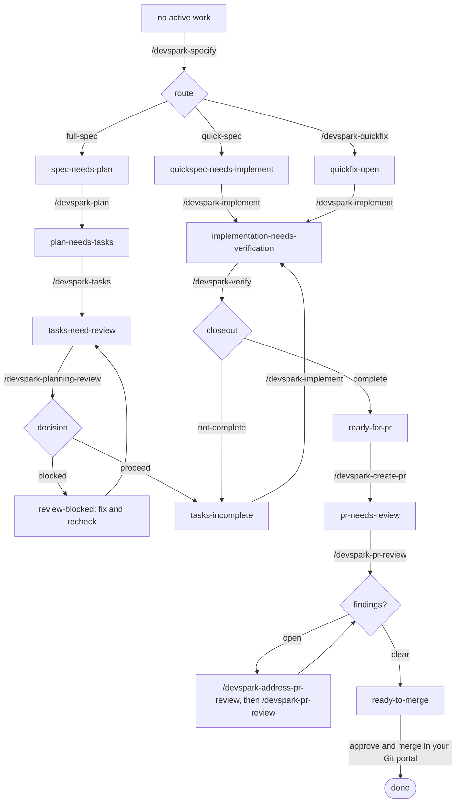

# Troubleshooting Your App

Diagnose first, then let the diagnosis choose the route. You do not need any DevSpark skill to investigate a bug: reproduce it, read the code, and find the root cause in your agent conversation. The size of the fix is a conclusion of that diagnosis.

Prerequisites: DevSpark installed (`.devspark/` present), a constitution at `.knowledge/governance/constitution.md`, and a git working tree you can branch from.

## Choose the fix size

| Signal from diagnosis | Route | Skill |
|---|---|---|
| Few files, clear root cause, about 4 hours or less, no API, schema, or architecture change | Quickfix | `/devspark-quickfix` |
| A little design or several files, but self-contained | Quick spec | `/devspark-specify` |
| Architectural, schema, or API-contract change, or scope you cannot judge | Full spec | `/devspark-specify` |

When unsure after diagnosis, start with `/devspark-specify`. It recommends a route and asks you to confirm before creating anything. If it classifies the request as a one-off fix, it points you to quickfix.

| Scenario | Start here |
|---|---|
| Null reference or obvious single-file bug | `/devspark-quickfix` |
| Production emergency | `/devspark-quickfix` (hotfix classification) |
| Config, flag, or environment tweak | `/devspark-quickfix` |
| Several files, no design change | `/devspark-specify` (quick spec) |
| Rooted in an architecture, schema, or API problem | `/devspark-specify` (full spec) |

## The quickfix flow

`/devspark-quickfix` is built to be invoked mid-investigation. It reads the conversation thread and turns it into a product-owner-friendly record.

```text
/devspark-quickfix Login page throws a null reference when the profile has no avatar
```

It classifies the change, runs only the constitution checks that apply, creates a dedicated branch, and commits a temporary record under `.devspark.work/quickfixes/` with:

- **WHAT**: the observed, user-visible problem.
- **WHY**: the root cause you found.
- **HOW**: the agreed fix.

Then apply the fix, run `/devspark-implement` (code, tests, and current knowledge together), and run `/devspark-verify`. Open the PR with `/devspark-create-pr`. The record stays live until `/devspark-release` archives it.

Quickfix runs a targeted check, not the full-spec gates, so it under-gates a bug that turns out to be architectural. If the change starts spanning modules or needs a schema or API change, stop and run `/devspark-specify` with the larger problem. Escalation is the supported path, and your WHAT/WHY/HOW record gives you a head start.

## Let `/devspark-next` drive

`/devspark-next` detects where you are and runs the single next step. With `--auto` it chains forward until it needs you.



Closeout is a phase of `/devspark-verify`, not a separate step. A `not-complete` decision sends you back to `/devspark-implement` for the open defects only. Obligations that can only be proven in a deployed environment are recorded as post-deploy requirements; they stay visible and unproven but do not block closeout or the pull request.

## A skill is not found or listed twice

Type the full hyphenated slash command, for example `/devspark-specify`. In GitHub Copilot, DevSpark skills are installed as native Agent Skills under `.github/skills/`. Short names and the retired dotted 8.x form are not recognized. If a skill appears twice, run the [upgrade](../get-started/upgrade.md#upgrading-from-8x) to retire the leftover 8.x entry points. A personal skill with the same name in your user profile is outside the repository, and DevSpark does not touch it.

## Related

- [Review and Audit](review-and-audit.md): `/devspark-create-pr`, `/devspark-pr-review`, and `/devspark-address-pr-review`.
- [Planning Review](planning-review.md): the checks that run before implementation on full specs.
- [Skill Catalog](prompt-lifecycle-mapping.md): every skill and its role.
