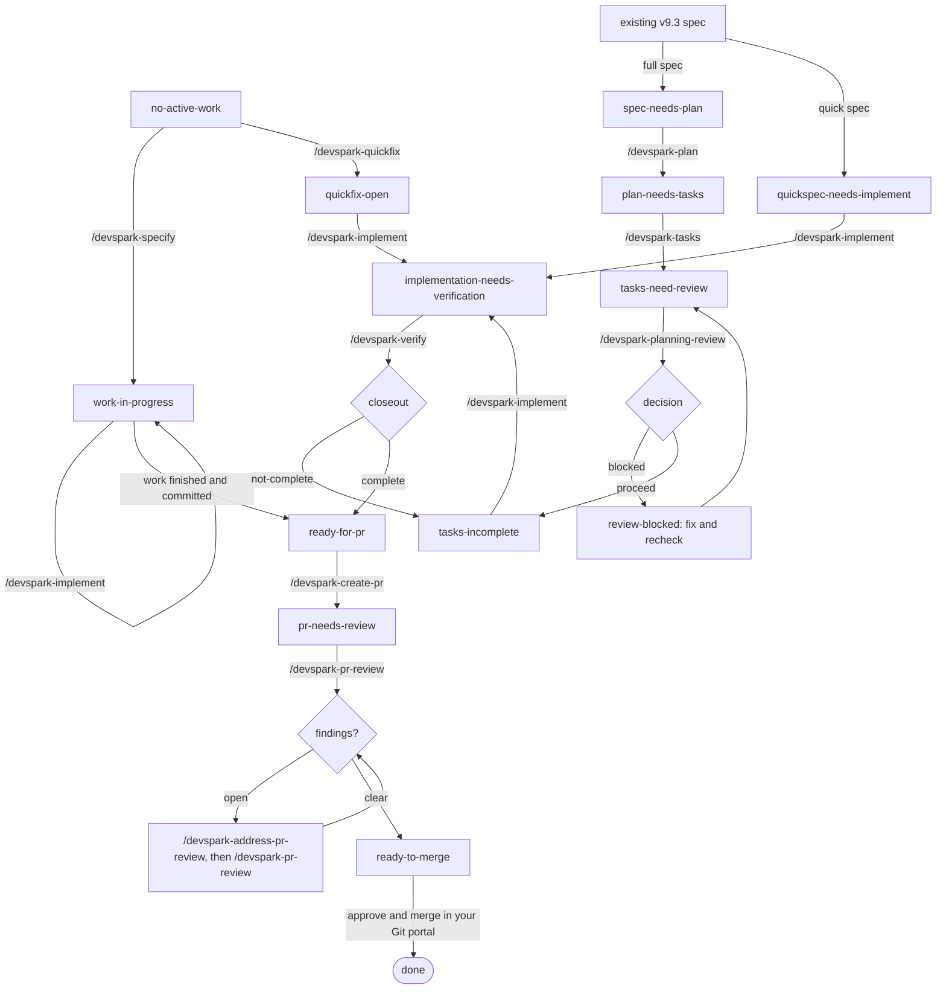

# Troubleshooting Your App

Diagnose first, then fix. You do not need any DevSpark skill to investigate a bug: reproduce it, read the code, and find the root cause in your agent conversation. The diagnosis tells you how much assurance the fix needs; it does not choose a workflow.

Prerequisites: DevSpark installed (`.devspark/` present), a constitution at `.knowledge/governance/constitution.md`, and a git working tree you can branch from.

## Start the fix

Every fix starts the same way. There is no size to choose.

| Situation | Start here |
|---|---|
| Any fix, from a single-file bug to an architectural, schema, or API problem | `/devspark-specify` |
| You already diagnosed it and want a WHAT/WHY/HOW record for a product owner | `/devspark-quickfix` (optional) |
| Production emergency | `/devspark-quickfix` (hotfix classification) or `/devspark-specify` |
| Work already under way on this branch | `/devspark-next` |

`/devspark-specify` creates a work branch, checks whether a material risk or mandatory obligation needs assurance, and goes straight to implementation. A schema, API, or security change does not switch routes; it adds only the specific assurance it justifies, such as a focused `/devspark-critic`.

## The quickfix flow

`/devspark-quickfix` is built to be invoked mid-investigation. It reads the conversation thread and turns it into a product-owner-friendly record.

```text
/devspark-quickfix Login page throws a null reference when the profile has no avatar
```

It classifies the change, runs only the constitution checks that apply, creates a dedicated branch, and commits a temporary record under `.devspark.work/quickfixes/` with:

- **WHAT**: the observed, user-visible problem.
- **WHY**: the root cause you found.
- **HOW**: the agreed fix.

Then apply the fix, run `/devspark-implement` (code, tests, and current knowledge together), and run `/devspark-verify`. Open the PR with `/devspark-create-pr`. The record stays live until `/devspark-release` archives it.

Quickfix runs a targeted check rather than a default review, so if the fix turns out to need a schema, API, or security change, it surfaces that decision to you. The quickfix keeps its route and gains only the assurance the concern justifies; a genuinely separate change starts with `/devspark-specify`.

## Let `/devspark-next` drive

`/devspark-next` detects where you are and runs the single next step. With `--auto` it chains forward until it needs you.



New work stays in `work-in-progress` while you implement and verify; `/devspark-verify` there answers delivered, verified, and eligible without writing a gate document. When `work.md` declares a required obligation that is still open, `/devspark-next` reports `delivery-blocked` instead of `ready-for-pr`. The lower half applies only to an existing v9.3 specification, which keeps its recorded route.

Closeout is a phase of `/devspark-verify`, not a separate step. A `not-complete` decision sends you back to `/devspark-implement` for the open defects only. Obligations that can only be proven in a deployed environment are recorded as post-deploy requirements; they stay visible and unproven but do not block closeout or the pull request.

## Delivery is blocked

When committed work fails the lifecycle check, `/devspark-next` reports `delivery-blocked`. Read the reason it names:

- **`required-obligation-unresolved`**: an entry under `## Required Obligations` in `work.md` is unchecked, or is checked without its `Authority:` or a traceable evidence or decision reference. `/devspark-create-pr` also refuses with `CREATE PR BLOCKED — REQUIRED OBLIGATION UNRESOLVED`. Obtain the evidence or decision from that authority, then check the entry and add the reference. More implementation does not resolve it. See [Assurance as needed](../get-started/how-it-works.md#assurance-as-needed).
- **Any other lifecycle failure**: `/devspark-next` recommends `/devspark-implement` to resolve it.

When the check cannot run (`judge-missing`, `python-unavailable`, or `invalid-output`) and `work.md` declares obligations, `/devspark-create-pr` refuses with `CREATE PR BLOCKED — LIFECYCLE CHECK UNAVAILABLE`, and `/devspark-next` says so in its reason. Restore the framework files with the quickstart in Repair Mode, or install Python, and try again. DevSpark has no override.

## A skill is not found or listed twice

Type the full hyphenated slash command, for example `/devspark-specify`. In GitHub Copilot, DevSpark skills are installed as native Agent Skills under `.github/skills/`. Short names and the retired dotted 8.x form are not recognized. If a skill appears twice, run the [upgrade](../get-started/upgrade.md#upgrading-from-8x) to retire the leftover 8.x entry points. A personal skill with the same name in your user profile is outside the repository, and DevSpark does not touch it.

## Related

- [Review and Audit](review-and-audit.md): `/devspark-create-pr`, `/devspark-pr-review`, and `/devspark-address-pr-review`.
- [Planning Review](planning-review.md): the checks that run before implementation on an existing v9.3 full specification.
- [Skill Catalog](prompt-lifecycle-mapping.md): every skill and its role.
